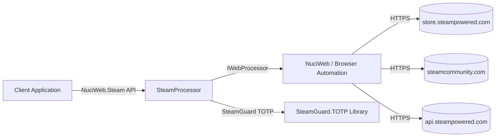
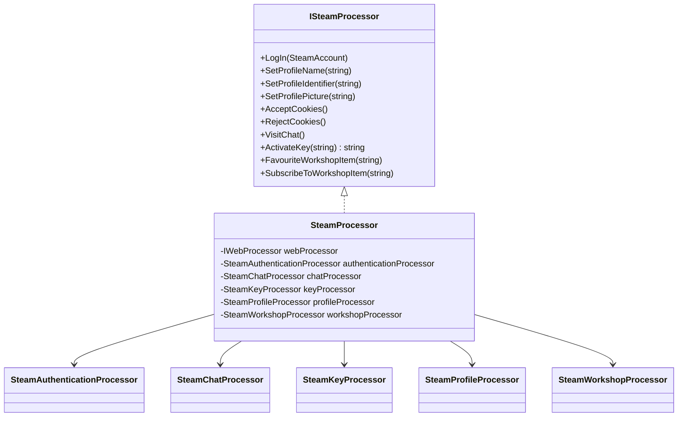
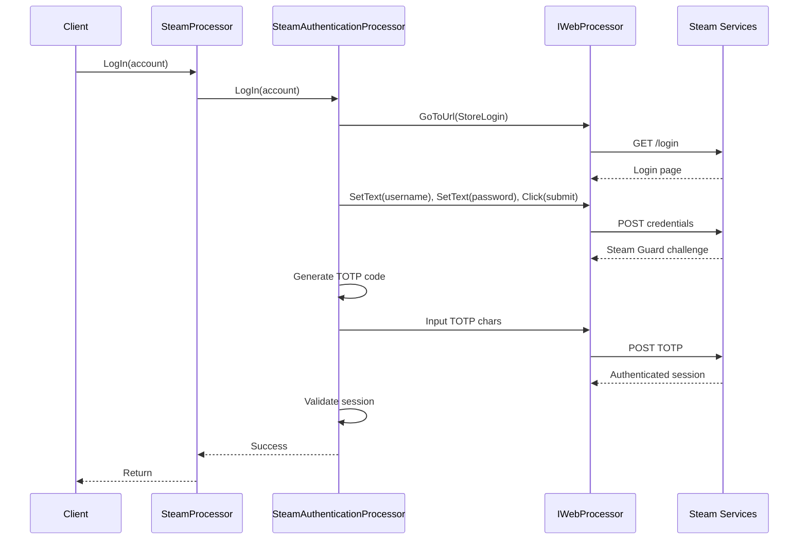
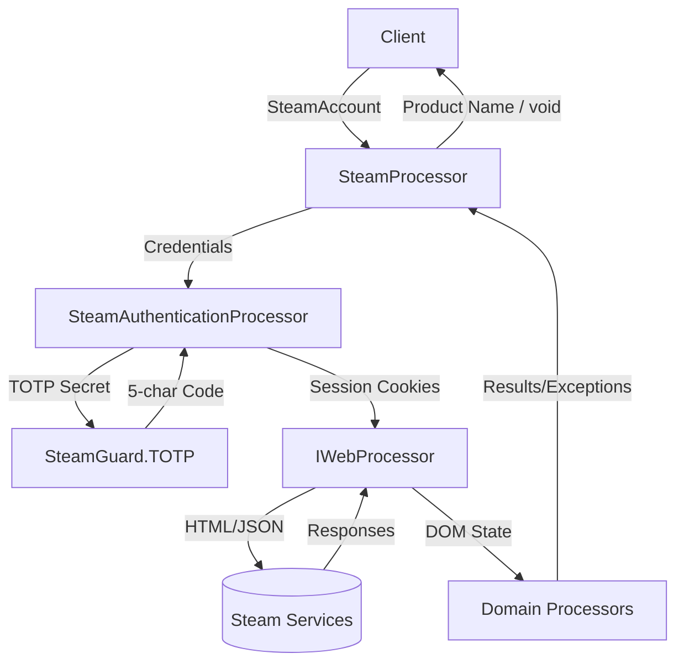
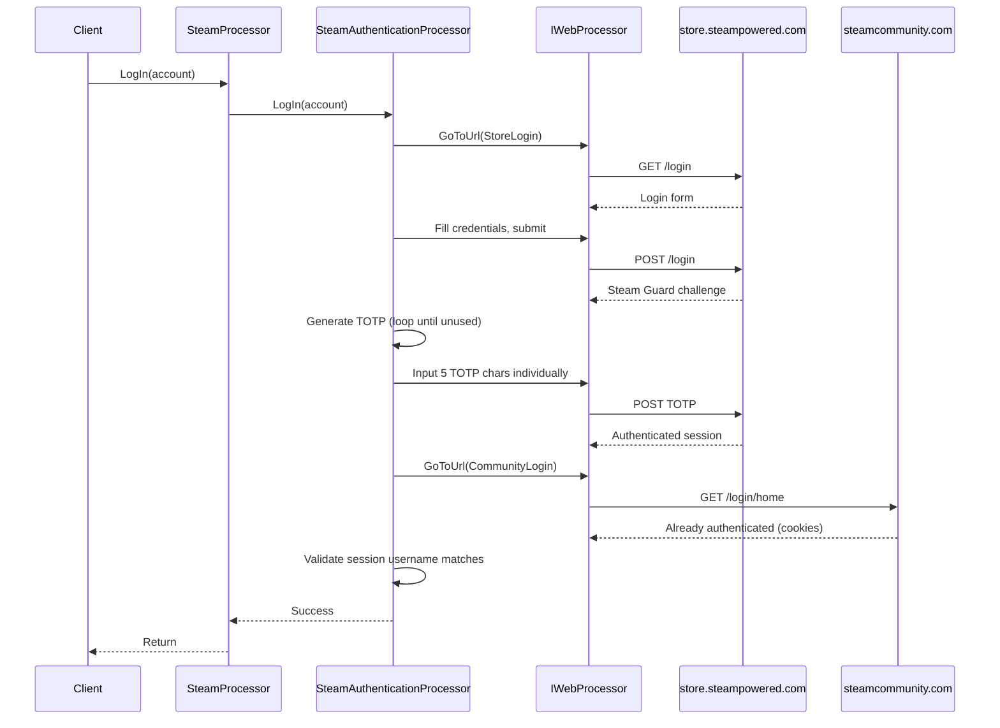
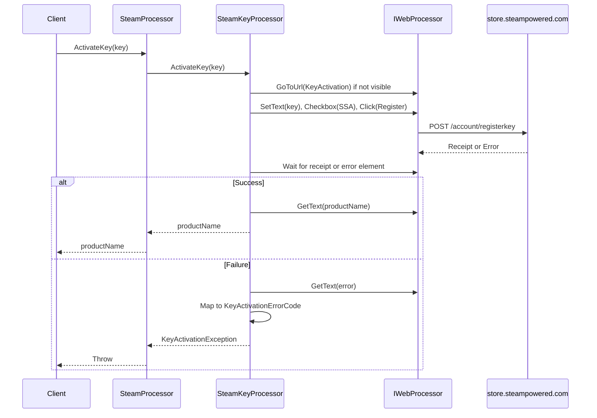
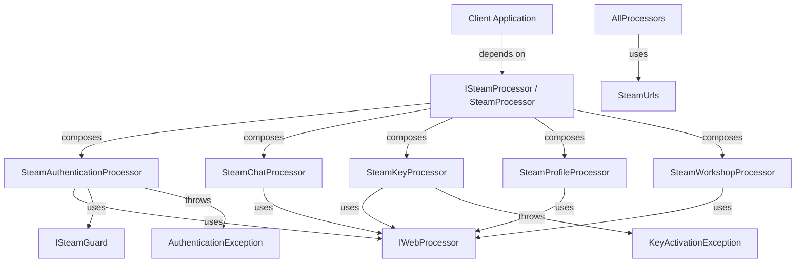

# NuciWeb.Steam Architecture

This document describes the current architecture of NuciWeb.Steam, a .NET library that provides high-level Steam account automation flows on top of NuciWeb (`IWebProcessor`).

## 📑 Table of Contents

- [Purpose](#purpose)
- [System Context](#system-context)
- [Architectural Style](#architectural-style)
- [Runtime Flow](#runtime-flow)
- [Components](#components)
- [Architectural Areas](#architectural-areas)
- [Data Architecture](#data-architecture)
- [Interfaces and Integrations](#interfaces-and-integrations)
- [Key Flows](#key-flows)
- [Cross-Cutting Concerns](#cross-cutting-concerns)
- [Dependency Direction and Rules](#dependency-direction-and-rules)
- [External Dependencies](#external-dependencies)
- [Deployment and Operations](#deployment-and-operations)
- [Compatibility Contracts](#compatibility-contracts)
- [Testing and Verification](#testing-and-verification)
- [Design Constraints](#design-constraints)
- [Extension Points](#extension-points)
- [Evolution and Migration](#evolution-and-migration)
- [Architecture Decisions](#architecture-decisions)
- [Source Map](#source-map)
- [Related Documentation](#related-documentation)

## 🎯 Purpose

NuciWeb.Steam automates common Steam account operations including authentication (with Steam Guard TOTP), cookie preference management, chat access, product key activation (with typed error handling), profile updates (name, custom URL, avatar), and Workshop interactions (favorite, subscribe). It targets developers building Steam automation tools and runs on .NET 10.0+.

## 🌐 System Context



The principal external boundaries are:
- **Steam Store (store.steampowered.com):** Account login, key activation, profile management; exchanges credentials, cookies, HTML forms
- **Steam Community (steamcommunity.com):** Chat, Workshop, profile avatar; exchanges session cookies, HTML/JSON
- **Steam Web API (api.steampowered.com):** Not directly used by current flows; reserved for future API-based operations
- **NuciWeb (IWebProcessor):** Browser automation abstraction; provides navigation, element interaction, waiting, JavaScript execution
- **SteamGuard.TOTP:** Generates time-based one-time passwords for 2FA; consumes shared secret, produces 5-character codes

## 🏗️ Architectural Style

**Facade with Composed Processors.** `SteamProcessor` implements the public `ISteamProcessor` interface and delegates to five internal processor classes, each owning a distinct Steam domain. This isolates page-specific selectors, navigation logic, and error handling per domain while presenting a unified synchronous API.



The principal architecture boundaries are:
- **Public API (`ISteamProcessor`):** Stable contract for consumers; no direct dependency on NuciWeb types
- **Internal Processors:** Encapsulate page-specific logic; depend on `IWebProcessor` and `SteamUrls`
- **Models (`SteamAccount`):** Data transfer object; no behaviour
- **Errors (`KeyActivationException`, `KeyActivationErrorCode`):** Typed failure semantics for key activation
- **Utilities (`SteamUrls`):** Centralised URL constants; no external dependencies

## 🔄 Runtime Flow



The principal runtime sequence is:
1. **Initialisation:** Client constructs `SteamProcessor` with `IWebProcessor` implementation
2. **Authentication:** `LogIn` navigates to store and community login pages, submits credentials, handles Steam Guard TOTP, validates resulting session
3. **Orchestration:** Subsequent calls delegate to specialised processors (profile, keys, chat, workshop)
4. **Result:** Operations return domain values (product name) or throw typed exceptions

## 🧩 Components

| Component | Responsibility | Principal Dependencies | Lifetime or Ownership |
|-----------|----------------|------------------------|-----------------------|
| `SteamProcessor` | Public facade; composes and delegates to domain processors | `IWebProcessor`, all internal processors | Owned by client; per-operation or long-lived |
| `SteamAuthenticationProcessor` | Login to store and community; Steam Guard TOTP handling; session validation | `IWebProcessor`, `ISteamGuard` (SteamGuard.TOTP), `SteamUrls` | Created by `SteamProcessor`; transient per `LogIn` |
| `SteamChatProcessor` | Navigate to chat and verify loaded | `IWebProcessor`, `SteamUrls` | Created by `SteamProcessor`; transient per `VisitChat` |
| `SteamKeyProcessor` | Product key activation with typed error mapping | `IWebProcessor`, `SteamUrls`, `KeyActivationException` | Created by `SteamProcessor`; transient per `ActivateKey` |
| `SteamProfileProcessor` | Profile name, custom URL, avatar updates | `IWebProcessor`, `SteamUrls` | Created by `SteamProcessor`; transient per profile operation |
| `SteamWorkshopProcessor` | Workshop item favourite and subscribe | `IWebProcessor`, `SteamUrls` | Created by `SteamProcessor`; transient per workshop operation |
| `SteamAccount` | Credentials container (username, password, TOTP shared secret) | None | Client-owned; passed to `LogIn` |
| `SteamUrls` | Centralised Steam URL constants | None | Static; process lifetime |
| `KeyActivationErrorCode` / `KeyActivationException` | Typed key activation failure semantics | None | Thrown by `SteamKeyProcessor`; caught by client |

## 🗂️ Architectural Areas

### Public API
Paths:
- `NuciWeb.Steam/ISteamProcessor.cs`
- `NuciWeb.Steam/SteamProcessor.cs`
- `NuciWeb.Steam/Models/SteamAccount.cs`
- `NuciWeb.Steam/KeyActivationErrorCode.cs`
- `NuciWeb.Steam/KeyActivationException.cs`

Responsibilities:
- Define stable consumer contract
- Compose internal processors
- Expose synchronous operations

Boundary rules:
- No NuciWeb types in public signatures
- No `async`/`Task` in public API (synchronous by design)
- All public members require XML documentation

### Authentication
Paths:
- `NuciWeb.Steam/Processors/ISteamAuthenticationProcessor.cs`
- `NuciWeb.Steam/Processors/SteamAuthenticationProcessor.cs`

Responsibilities:
- Dual login (store + community)
- Steam Guard TOTP generation and input
- Session validation and re-use detection
- Captcha and error detection

Boundary rules:
- Internal interface only; not exposed publicly
- Depends on `ISteamGuard` abstraction for testability
- Tracks used TOTP codes in-memory to avoid reuse

### Profile Management
Paths:
- `NuciWeb.Steam/Processors/ISteamProfileProcessor.cs`
- `NuciWeb.Steam/Processors/SteamProfileProcessor.cs`

Responsibilities:
- Display name update
- Custom URL update
- Avatar upload and confirmation

Boundary rules:
- Navigates via profile page → edit page flow
- Uses JavaScript to reveal hidden file input for avatar

### Key Activation
Paths:
- `NuciWeb.Steam/Processors/ISteamKeyProcessor.cs`
- `NuciWeb.Steam/Processors/SteamKeyProcessor.cs`

Responsibilities:
- Navigate to key activation page
- Submit key with SSA agreement
- Map localised error messages to `KeyActivationErrorCode`

Boundary rules:
- Returns product name on success
- Throws `KeyActivationException` with specific error code on failure
- Supports English and Romanian error message detection

### Chat & Workshop
Paths:
- `NuciWeb.Steam/Processors/ISteamChatProcessor.cs`
- `NuciWeb.Steam/Processors/SteamChatProcessor.cs`
- `NuciWeb.Steam/Processors/ISteamWorkshopProcessor.cs`
- `NuciWeb.Steam/Processors/SteamWorkshopProcessor.cs`

Responsibilities:
- Chat: Navigate and verify loaded
- Workshop: Favourite and subscribe with idempotency checks

Boundary rules:
- Workshop operations verify current state before acting
- Handles modal dialogs for required base products

### Utilities
Paths:
- `NuciWeb.Steam/Utils/SteamUrls.cs`

Responsibilities:
- Centralised URL construction for all Steam endpoints

Boundary rules:
- Static class; no external dependencies
- Format string for workshop item URLs

## 💾 Data Architecture



| Data or Store | Owner | Representation and Storage | Lifecycle or Consistency |
|---------------|-------|----------------------------|--------------------------|
| `SteamAccount` | Client | POCO with Username, Password, TotpKey | Created by client; passed to `LogIn`; not retained |
| Steam Guard Shared Secret | Client | String (Base32) | Provided by client; used only during `LogIn` |
| Session Cookies | `IWebProcessor` | Browser cookie jar | Managed by NuciWeb; persists across operations |
| TOTP Codes (used) | `SteamAuthenticationProcessor` | `List<string>` in-memory | Cleared per `LogIn` call; prevents code reuse |
| Key Activation Result | `SteamKeyProcessor` | Product name string or `KeyActivationException` | Returned immediately; not persisted |
| Profile/Workshop State | Steam Services | Server-side | Read via DOM scraping; not cached locally |

## 🔌 Interfaces and Integrations

| Interface or Integration | Direction | Contract | Owner | Failure Semantics |
|--------------------------|-----------|----------|-------|-------------------|
| `ISteamProcessor` | Inbound | 9 synchronous methods | `SteamProcessor` | Throws `KeyActivationException`, `AuthenticationException`, `ArgumentNullException` |
| `IWebProcessor` | Outbound | Navigation, element interaction, waiting, JS execution | NuciWeb | Throws on timeout, element not found, navigation failure |
| `ISteamGuard` (SteamGuard.TOTP) | Outbound | `GenerateAuthenticationCode(string)` | SteamGuard.TOTP | Returns null/empty on invalid secret |
| Steam Store (store.steampowered.com) | Outbound | HTML forms, cookie-based auth | Steam | HTTP errors, captcha, rate limits |
| Steam Community (steamcommunity.com) | Outbound | HTML pages, AJAX endpoints | Steam | HTTP errors, session expiry |

## 🔀 Key Flows

### Login Flow



Ordering and invariants:
- Store login always precedes community login (cookies transfer)
- TOTP codes are single-use; processor loops until unused code generated
- Session validated on both domains by checking displayed username
- Captcha throws `AuthenticationException` immediately

### Key Activation Flow



Error mapping covers: invalid key, already activated (different/current account), base product required, region locked, too many attempts, unexpected error. Localised messages (English, Romanian) are matched.

## 🧵 Cross-Cutting Concerns

### Security and Privacy

- **Credentials:** `SteamAccount` held only in-memory during `LogIn`; never logged, persisted, or exposed
- **TOTP Shared Secret:** Passed to `SteamGuard.TOTP` library; not retained after code generation
- **Session Cookies:** Managed by `IWebProcessor` (NuciWeb); library does not access cookie values directly
- **HTTPS Only:** All Steam endpoints use HTTPS via `SteamUrls` constants
- **No Telemetry:** Library emits no diagnostics, metrics, or usage data

### Error Handling

- **Authentication Failures:** `AuthenticationException` for captcha, wrong credentials, TOTP mismatch, session mismatch
- **Key Activation Failures:** `KeyActivationException` with `KeyActivationErrorCode` for typed handling
- **Element/Navigation Failures:** Propagated from `IWebProcessor` (timeouts, missing elements)
- **Validation:** Input validation at entry points (null/empty checks on TOTP key, product key)
- **Degradation:** None; operations either succeed or throw

### Observability

- **No Built-in Logging:** Library does not log; consumers wrap calls for audit
- **Exceptions as Signals:** All failures surface as exceptions with descriptive messages
- **No Health Checks:** Not a long-running service; no liveness/readiness endpoints

### Configuration

| Configuration Area | Source | Responsibility | Override or Secret Policy |
|--------------------|--------|----------------|---------------------------|
| Steam URLs | `SteamUrls` (code) | Endpoint constants | Compile-time only; no runtime override |
| TOTP Implementation | Constructor injection | `ISteamGuard` abstraction | Default: `SteamGuard.TOTP.SteamGuard`; testable via injection |
| Browser/Automation | `IWebProcessor` injection | Navigation, interaction | Provided by consumer (NuciWeb, Selenium, etc.) |

### Concurrency and Resource Use

- **Not Thread-Safe:** `SteamProcessor` and internal processors hold no synchronisation; single-threaded use expected
- **Browser Session:** `IWebProcessor` manages browser lifecycle; concurrent operations on same instance race
- **TOTP Code Tracking:** `UsedSteamGuardCodes` list is per-processor instance; not shared
- **Resource Disposal:** Delegated to `IWebProcessor` implementation; library holds no unmanaged resources

## 🧭 Dependency Direction and Rules



The principal dependency rules are:
- Public API (`ISteamProcessor`, `SteamAccount`, `KeyActivationErrorCode`, `KeyActivationException`) has no dependencies on NuciWeb or automation types
- Internal processors depend on `IWebProcessor` (abstraction) and `SteamUrls` (constants)
- `SteamAuthenticationProcessor` depends on `ISteamGuard` abstraction for TOTP (enables testing)
- No circular dependencies; strict layering: Client → Facade → Processors → Abstractions/Utilities
- `SteamUrls` is a leaf dependency (no outbound dependencies)

## 📦 External Dependencies

| Dependency | Responsibility | Integration Boundary | Architectural Consequence |
|------------|----------------|----------------------|---------------------------|
| `NuciWeb` (4.1.0) | `IWebProcessor` implementation; browser automation | Injected into `SteamProcessor` constructor | Consumer chooses automation backend; library is backend-agnostic |
| `NuciWeb.Automation` (1.0.1) | `Select` helpers (XPath, ID, class, name) | Used by all processors for element location | Tight coupling to NuciWeb selector API; migration requires selector updates |
| `NuciExtensions` (6.0.2) | Extension methods (e.g., `ClickAny`, `WaitForAnyElementToBeVisible`) | Used by processors | Convenience APIs; could be replaced with direct `IWebProcessor` calls |
| `SteamGuard.TOTP` (1.1.1) | `ISteamGuard` implementation for TOTP generation | Injected into `SteamAuthenticationProcessor` | Standard RFC 6238 TOTP; replaceable for testing or alternative impl |

## 🚀 Deployment and Operations

| Concern | Current Design | Architectural Consequence |
|---------|----------------|---------------------------|
| **Distribution** | NuGet package (`NuciWeb.Steam`) | Consumers reference via `dotnet add package`; no runtime installation |
| **Runtime** | .NET 10.0+ | Requires compatible .NET runtime on consumer machine |
| **Browser** | Delegated to `IWebProcessor` (NuciWeb uses WebDriver) | Consumer must provide WebDriver (ChromeDriver, GeckoDriver, etc.) |
| **State** | No persistent state in library | Stateless per-operation; session cookies managed by `IWebProcessor` |
| **Scaling** | Single-threaded per `SteamProcessor` instance | Parallelism requires separate `IWebProcessor`/browser instances |
| **Startup** | Constructor injection only | No async initialisation; ready immediately |
| **Shutdown** | `IWebProcessor.Dispose()` | Consumer responsible for disposing browser |

## 🛡️ Compatibility Contracts

| Contract | Owner | Invariant | Verification | Change Policy |
|----------|-------|-----------|--------------|---------------|
| `ISteamProcessor` | `SteamProcessor` | Method signatures, exception types, return types | Compile-time; consumer builds | Non-breaking only; new methods via interface extension or new interface |
| `SteamAccount` | `Models` | Property names, types, public setters | Compile-time | Additive only (new properties) |
| `KeyActivationErrorCode` | Root namespace | Enum values, ordering | Compile-time; consumer `switch` | Additive only; never reorder or remove |
| `KeyActivationException` | Root namespace | Constructor overloads, `Code` property | Compile-time; catch blocks | Additive constructors only |
| Steam URL Formats | `SteamUrls` | URL patterns for login, key activation, workshop | Runtime (navigation succeeds) | Update on Steam site changes; version bump |

## ✅ Testing and Verification

Execute the principal automated verification with:

```bash
dotnet test NuciWeb.Steam.slnx
```

- **Unit Tests:** Not present in repository; processors are integration-heavy (require browser)
- **Integration Tests:** Manual via consumer applications; no automated test project
- **Architecture Verification:** Compile-time checks via public API surface; dependency direction enforced by `internal` processor interfaces

## ⚠️ Design Constraints

- **Synchronous API:** All public methods are synchronous; `IWebProcessor` operations block. No `async`/`await` in public contract.
- **Single-Threaded:** Processors maintain in-memory state (used TOTP codes); not safe for concurrent use.
- **Browser Dependency:** Requires `IWebProcessor` implementation (NuciWeb + WebDriver); no headless/API-only mode.
- **Page Scraping:** All operations rely on Steam's HTML structure; brittle to UI changes.
- **Localisation Assumptions:** Error message matching covers English and Romanian only; other locales may not map to typed errors.
- **No API Fallback:** Does not use Steam Web API; purely browser automation.

## 🔧 Extension Points

### Custom Authentication Flow

1. Implement `ISteamAuthenticationProcessor` with custom logic
2. Construct `SteamProcessor` using internal constructor (not public) or fork
3. Add verification for session validation invariants

**Conventions:** Must accept `SteamAccount`, throw `AuthenticationException` on failure, validate resulting session.

### Additional Processor Domains

1. Create `ISteamXxxProcessor` interface and `SteamXxxProcessor` implementation
2. Add field and delegation in `SteamProcessor`
3. Expose method on `ISteamProcessor` (breaking) or new interface (non-breaking)

**Conventions:** Constructor takes `IWebProcessor`; uses `SteamUrls` for navigation; internal visibility.

### Alternative TOTP Provider

1. Implement `ISteamGuard` (from SteamGuard.TOTP or custom)
2. Inject via `SteamAuthenticationProcessor` constructor overload

**Conventions:** `GenerateAuthenticationCode(string)` returns 5-char code or null.

## 🌱 Evolution and Migration

### Current State

Facade with five composed processors; synchronous API; browser automation via NuciWeb; typed key activation errors; dual-domain login.

### Target State

- Consider `async` API variant alongside synchronous
- Evaluate Steam Web API for read operations (profile, inventory) to reduce browser dependency
- Add support for additional locales in error mapping

### Transition

1. Introduce `ISteamProcessorAsync` with `Task`-returning methods
2. Implement in `SteamProcessor` alongside synchronous methods
3. Deprecate synchronous methods in future major version

Compatibility requirements:
- Existing `ISteamProcessor` remains unchanged
- `SteamAccount` and error types stable
- `IWebProcessor` contract stable

## 📝 Architecture Decisions

| Decision | Rationale | Consequence | Record |
|----------|-----------|-------------|--------|
| Synchronous public API | Simplicity for automation scripts; avoids async complexity in consumer code | Blocks calling thread; no cancellation support | Documented here |
| Facade with composed processors | Separation of concerns per Steam domain; testable units | More classes; delegation overhead | Documented here |
| Internal processor interfaces | Encapsulation; prevents consumer coupling to implementations | Cannot replace individual processors externally | Documented here |
| `ISteamGuard` abstraction | Testability; allows mock TOTP generation | Extra constructor parameter; default provided | Documented here |
| Typed `KeyActivationException` | Enables consumer error handling without string parsing | New error codes require library update | Documented here |
| Browser automation only (no Web API) | Steam Web API limited for account operations; browser covers all flows | Brittle to UI changes; requires WebDriver | Document here |

## 🗺️ Source Map

| Area | Path |
|------|------|
| Public API | `NuciWeb.Steam/ISteamProcessor.cs`, `NuciWeb.Steam/SteamProcessor.cs` |
| Models | `NuciWeb.Steam/Models/SteamAccount.cs` |
| Errors | `NuciWeb.Steam/KeyActivationErrorCode.cs`, `NuciWeb.Steam/KeyActivationException.cs` |
| Authentication | `NuciWeb.Steam/Processors/ISteamAuthenticationProcessor.cs`, `NuciWeb.Steam/Processors/SteamAuthenticationProcessor.cs` |
| Profile | `NuciWeb.Steam/Processors/ISteamProfileProcessor.cs`, `NuciWeb.Steam/Processors/SteamProfileProcessor.cs` |
| Key Activation | `NuciWeb.Steam/Processors/ISteamKeyProcessor.cs`, `NuciWeb.Steam/Processors/SteamKeyProcessor.cs` |
| Chat | `NuciWeb.Steam/Processors/ISteamChatProcessor.cs`, `NuciWeb.Steam/Processors/SteamChatProcessor.cs` |
| Workshop | `NuciWeb.Steam/Processors/ISteamWorkshopProcessor.cs`, `NuciWeb.Steam/Processors/SteamWorkshopProcessor.cs` |
| Utilities | `NuciWeb.Steam/Utils/SteamUrls.cs` |
| Project Config | `NuciWeb.Steam/NuciWeb.Steam.csproj` |

## 📚 Related Documentation

- [README.md](./README.md) — Project overview, installation, usage, contributing
- [PRIVACY.md](./PRIVACY.md) — Data handling, retention, privacy details
- [SECURITY.md](./SECURITY.md) — Vulnerability reporting, disclosure policy
- [CONTRIBUTING.md](./CONTRIBUTING.md) — Contribution guidelines, coding standards
- [CODE_OF_CONDUCT.md](./CODE_OF_CONDUCT.md) — Community standards
- [LICENSE](./LICENSE) — GNU GPL v3.0 or later