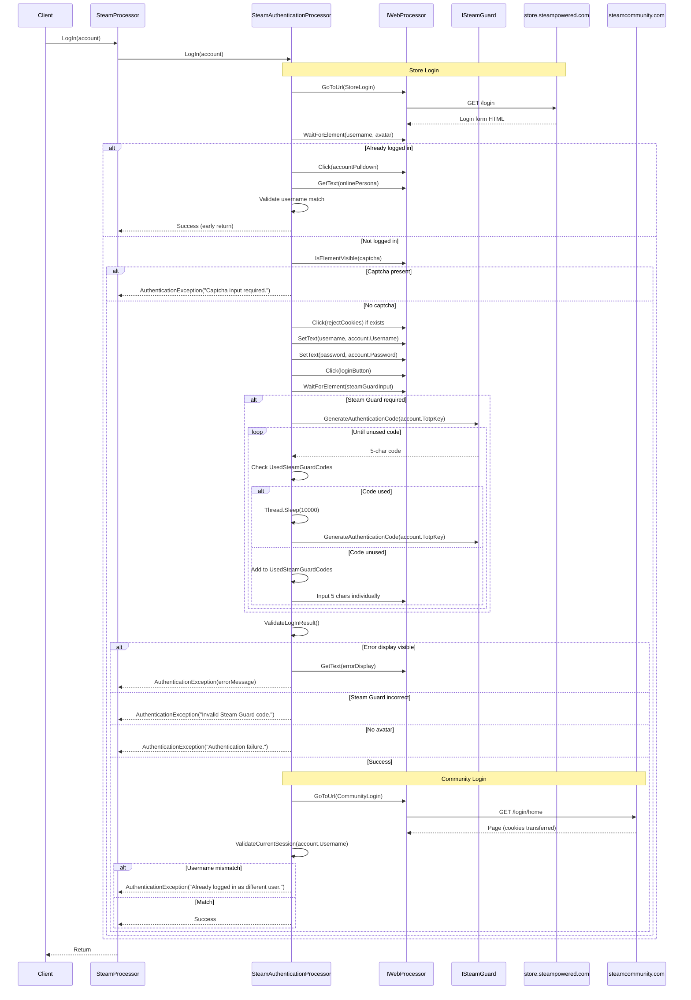

# Authentication Flow

## Overview

The authentication flow handles dual-domain login (Steam Store + Steam Community) with Steam Guard TOTP support, session validation, and captcha detection.

## Sequence Diagram



## Detailed Steps

### 1. Store Login (`LogInOnPage` with `SteamUrls.StoreLogin`)

**Navigation:**
```csharp
webProcessor.GoToUrl(SteamUrls.StoreLogin); // https://store.steampowered.com/login
webProcessor.Wait(TimeSpan.FromSeconds(2));
```

**Already Logged In Check:**
```csharp
// Selectors
avatarSelector = Select.ByXPath("//a[contains(@class,'playerAvatar')]");
accountPulldownSelector = Select.ById("account_pulldown");

if (webProcessor.AreAllElementsVisible(avatarSelector, accountPulldownSelector))
{
    ValidateCurrentSession(account.Username);
    return; // Early exit - already authenticated
}
```

**Captcha Detection:**
```csharp
captchaInputSelector = Select.ById("input_captcha");
if (webProcessor.IsElementVisible(captchaInputSelector))
{
    throw new AuthenticationException("Captcha input required.");
}
```

**Cookie Consent:**
```csharp
rejectCookiesButtonSelector = Select.ById("rejectAllButton");
if (webProcessor.DoesElementExist(rejectCookiesButtonSelector))
{
    webProcessor.Click(rejectCookiesButtonSelector);
}
```

**Credential Submission:**
```csharp
usernameSelector = Select.ByXPath("//form/div[1]/label/../input");
passwordSelector = Select.ByXPath("//form/div[2]/label/../input");
logInButtonSelector = Select.ByXPath("//form/div[4]/button[@type='submit']");

webProcessor.SetText(usernameSelector, account.Username);
webProcessor.SetText(passwordSelector, account.Password);
webProcessor.Click(logInButtonSelector);
```

**Steam Guard Challenge:**
```csharp
steamGuardCodeInputSelector = Select.ByXPath(SteamGuardCodeInputXPath);
// SteamGuardCodeInputXPath = "//form/section/div[2]/section/div/input/.."

webProcessor.WaitForElementToBeVisible(steamGuardCodeInputSelector);

if (webProcessor.IsElementVisible(steamGuardCodeInputSelector))
{
    InputSteamGuardCode(account.TotpKey);
}
```

### 2. Steam Guard TOTP Input (`InputSteamGuardCode`)

```csharp
void InputSteamGuardCode(string totpKey)
{
    if (string.IsNullOrWhiteSpace(totpKey))
        throw new ArgumentNullException(nameof(totpKey));

    webProcessor.WaitForElementToBeVisible(steamGuardCodeInputSelector);

    string steamGuardCode = steamGuard.GenerateAuthenticationCode(totpKey);

    // Retry loop for unused code
    while (string.IsNullOrWhiteSpace(steamGuardCode) || UsedSteamGuardCodes.Contains(steamGuardCode))
    {
        steamGuardCode = steamGuard.GenerateAuthenticationCode(totpKey);
        Thread.Sleep(10000); // TODO: Remove this!
    }

    UsedSteamGuardCodes.Add(steamGuardCode);

    // Input 5 characters into separate fields
    for (int i = 0; i < 5; i++)
    {
        string charSelector = Select.ByXPath($"{SteamGuardCodeInputXPath}/input[{i + 1}]");
        webProcessor.SetText(charSelector, steamGuardCode[i].ToString());
    }
}
```

**Key Behaviours:**
- Generates TOTP via injected `ISteamGuard` (default: `SteamGuard.TOTP.SteamGuard`)
- Tracks used codes in `UsedSteamGuardCodes` list (per `LogIn` call)
- Waits 10 seconds between generations if code already used (known issue)
- Inputs each character into separate input field (Steam Guard UI design)

### 3. Login Result Validation (`ValidateLogInResult`)

```csharp
void ValidateLogInResult()
{
    avatarSelector = Select.ByClass("user_avatar");
    errorBoxSelector = Select.ById("error_display");
    steamGuardIncorrectMessageSelector = Select.ById("login_twofactorauth_message_incorrectcode");

    webProcessor.WaitForAnyElementToBeVisible(
        avatarSelector,
        steamGuardIncorrectMessageSelector,
        errorBoxSelector);

    if (webProcessor.IsElementVisible(errorBoxSelector))
    {
        throw new AuthenticationException(webProcessor.GetText(errorBoxSelector));
    }
    else if (webProcessor.IsElementVisible(steamGuardIncorrectMessageSelector))
    {
        throw new AuthenticationException("The provided Steam Guard code is not valid.");
    }
    else if (!webProcessor.IsElementVisible(avatarSelector))
    {
        throw new AuthenticationException("Authentication failure.");
    }
    // Success: avatar visible, no errors
}
```

### 4. Community Login (`LogInOnPage` with `SteamUrls.CommunityLogin`)

**Navigation:**
```csharp
webProcessor.GoToUrl(SteamUrls.CommunityLogin); // https://steamcommunity.com/login/home
```

**Session Validation:**
```csharp
void ValidateCurrentSession(string expectedUsername)
{
    accountPulldownSelector = Select.ById("account_pulldown");
    onlinePersonaSelector = Select.ByXPath("//div[@class='popup_body popup_menu']/a[2]/span[@class='account_name']");

    webProcessor.Click(accountPulldownSelector);
    webProcessor.WaitForAnyElementToBeVisible(onlinePersonaSelector);

    string currentUsername = webProcessor.GetText(onlinePersonaSelector).Trim();

    if (!currentUsername.Equals(expectedUsername, StringComparison.InvariantCultureIgnoreCase))
    {
        throw new AuthenticationException($"Already logged in as a different user ('{currentUsername}').");
    }
}
```

## Selectors Reference

| Element | Selector | Type |
|---------|----------|------|
| Username input | `//form/div[1]/label/../input` | XPath |
| Password input | `//form/div[2]/label/../input` | XPath |
| Captcha input | `#input_captcha` | ID |
| Login button | `//form/div[4]/button[@type='submit']` | XPath |
| Steam Guard container | `//form/section/div[2]/section/div/input/..` | XPath |
| Steam Guard char input | `//form/section/div[2]/section/div/input/.. /input[{n}]` | XPath |
| Avatar (pre-login check) | `//a[contains(@class,'playerAvatar')]` | XPath |
| Account pulldown | `#account_pulldown` | ID |
| Online persona name | `//div[@class='popup_body popup_menu']/a[2]/span[@class='account_name']` | XPath |
| User avatar (post-login) | `.user_avatar` | Class |
| Error display | `#error_display` | ID |
| Steam Guard incorrect | `#login_twofactorauth_message_incorrectcode` | ID |
| Reject cookies button | `#rejectAllButton` | ID |

## Error Scenarios

| Scenario | Exception | Message | Recovery |
|----------|-----------|---------|----------|
| Null TOTP key | `ArgumentNullException` | "Value cannot be null. (Parameter 'totpKey')" | Provide valid TotpKey |
| Captcha required | `AuthenticationException` | "Captcha input required." | Manual intervention needed |
| Steam Guard code invalid | `AuthenticationException` | "The provided Steam Guard code is not valid." | Retry with new code (auto-retried) |
| General error display | `AuthenticationException` | Steam's error message | Check credentials, account status |
| No avatar after login | `AuthenticationException` | "Authentication failure." | Investigate Steam response |
| Username mismatch (community) | `AuthenticationException` | "Already logged in as a different user ('X')." | Clear cookies, retry |
| WebDriver timeout | `TimeoutException` | Element not visible | Network issues, selector changes |

## Invariants

1. **Store login always precedes community login** — Cookies transfer from store to community
2. **TOTP codes are single-use** — `UsedSteamGuardCodes` prevents reuse within one `LogIn` call
3. **Session validated on both domains** — Username must match on store and community
4. **Captcha fails immediately** — No retry, requires manual intervention
5. **Cookie consent handled** — Rejects cookies if prompt appears

## Known Issues

1. **Hardcoded 10-second sleep** in TOTP retry loop (`Thread.Sleep(10000)`) — marked with TODO
2. **English/Romanian only** for error message detection in other processors
3. **Brittle XPath selectors** — depend on Steam's HTML structure
4. **No async support** — blocks calling thread during waits

## Testing

Manual verification required:
1. Valid credentials + valid TOTP → Success
2. Valid credentials + invalid TOTP → `AuthenticationException` (Steam Guard incorrect)
3. Invalid credentials → `AuthenticationException` (error display)
4. Captcha triggered → `AuthenticationException` (captcha required)
5. Already logged in as different user → `AuthenticationException` (username mismatch)
6. Valid credentials, already logged in (same user) → Early return success

## Related Documentation

- [Startup and Initialisation](./startup-and-rendering.md) — Processor construction
- [Application Services](../components/application-services.md#steamauthenticationprocessor) — Implementation details
- [Error Handling](../error-handling.md) — Exception taxonomy
- [Integration Models](../components/integration-models.md#steam-store-store-steampoweredcom) — Steam Store boundary