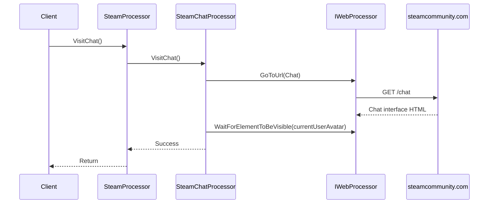

# Chat Access Flow

## Overview

The chat access flow handles navigation to Steam Chat on Steam Community. It is the simplest flow — a single navigation with a wait for the chat interface to load.

## Sequence Diagram



## Detailed Steps

### VisitChat

```csharp
public void VisitChat()
{
    webProcessor.GoToUrl(SteamUrls.Chat); // https://steamcommunity.com/chat
    webProcessor.WaitForElementToBeVisible(currentUserAvatarSelector);
}
```

**Selector:**
| Element | Selector | Type |
|---------|----------|------|
| Current user avatar | `#currentUserAvatar` | ID |

---

## Selectors Reference

| Element | Selector | Type |
|---------|----------|------|
| Current user avatar | `#currentUserAvatar` | ID |

---

## Error Scenarios

| Scenario | Exception | Recovery |
|----------|-----------|----------|
| Not logged in | `IWebProcessor` exception (element not found) | Call `LogIn` first |
| Chat unavailable | `TimeoutException` (avatar not visible) | Retry, check Steam status |
| Network error | `IWebProcessor` exception | Retry operation |
| Page structure changed | `NoSuchElementException` | Update selector |

---

## Invariants

1. **Single navigation** — Direct to `https://steamcommunity.com/chat`
2. **Wait for avatar** — `#currentUserAvatar` indicates chat interface loaded
3. **No interaction** — Does not send messages, join rooms, or perform any chat actions
4. **Void return** — Success indicated by no exception

---

## Known Issues

1. **No timeout on wait** — `WaitForElementToBeVisible` may hang indefinitely
2. **Assumes logged in** — No authentication check, fails silently if not logged in
3. **English-only UI assumption** — Selector may not work with other Steam languages
4. **Minimal functionality** — Only navigates to chat, no further interaction

---

## Testing

Manual verification required:
1. Logged in user → Chat interface loads, avatar visible
2. Not logged in → Exception (element not found or redirect)
3. Network interruption → Timeout or exception

---

## Related Documentation

- [Startup and Initialisation](./startup-and-rendering.md) — Processor construction
- [Application Services](../components/application-services.md#steamchatprocessor) — Implementation details
- [Integration Models](../components/integration-models.md#steam-community-steamcommunitycom) — Steam Community boundary
- [API Reference](../api-reference/steam-processor.md#visitchat) — Method signature