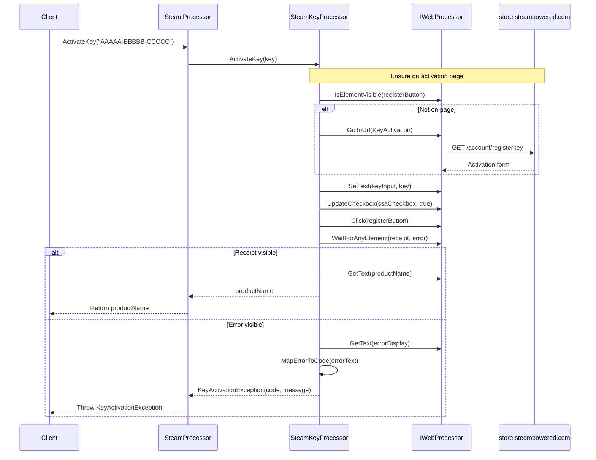

# Key Activation Flow

## Overview

The key activation flow handles product key redemption on Steam Store with SSA agreement, localised error mapping, and typed exception throwing.

## Sequence Diagram



## Detailed Steps

### 1. Navigation to Activation Page

```csharp
registerButtonSelector = Select.ById("register_btn");

if (!webProcessor.IsElementVisible(registerButtonSelector))
{
    webProcessor.GoToUrl(SteamUrls.KeyActivation); // https://store.steampowered.com/account/registerkey
    webProcessor.WaitForElementToBeVisible(registerButtonSelector);
}
```

**Behaviour:** Only navigates if not already on the activation page (idempotent).

### 2. Form Submission

```csharp
productKeyInputSelector = Select.ById("product_key");
ssaCheckboxSelector = Select.ById("accept_ssa");

webProcessor.SetText(productKeyInputSelector, key);
webProcessor.UpdateCheckbox(ssaCheckboxSelector, true);
webProcessor.Click(registerButtonSelector);
```

**Selectors:**
| Element | Selector | Type |
|---------|----------|------|
| Product key input | `#product_key` | ID |
| SSA checkbox | `#accept_ssa` | ID |
| Register button | `#register_btn` | ID |

### 3. Result Waiting

```csharp
receiptSelector = Select.ById("register_receipt");
errorDisplaySelector = Select.ById("error_display");

webProcessor.WaitForAnyElementToBeVisible(receiptSelector, errorDisplaySelector);
```

**Waits for either:**
- Success receipt (`#register_receipt`)
- Error display (`#error_display`)

### 4. Success Path

```csharp
if (webProcessor.IsElementVisible(receiptSelector))
{
    productNameSelector = Select.ByXPath("//div[@id='register_receipt']/div[2]/div[2]/div[1]/div[1]/div[1]/div[1]/h2");
    string productName = webProcessor.GetText(productNameSelector);
    return productName;
}
```

**Receipt Structure:**
```html
<div id="register_receipt">
  <div>...</div>
  <div>
    <div>...</div>
    <div>
      <div>
        <div>
          <div>
            <h2>Product Name</h2>  <!-- Target -->
          </div>
        </div>
      </div>
    </div>
  </div>
</div>
```

### 5. Error Path

```csharp
if (webProcessor.IsElementVisible(errorDisplaySelector))
{
    string errorMessage = webProcessor.GetText(errorDisplaySelector);
    KeyActivationErrorCode errorCode = MapErrorToCode(errorMessage);
    throw new KeyActivationException(errorCode, errorMessage);
}
```

### 6. Error Mapping (`MapErrorToCode`)

```csharp
KeyActivationErrorCode MapErrorToCode(string errorMessage)
{
    // English patterns
    if (errorMessage.Contains("Invalid product code"))
        return KeyActivationErrorCode.InvalidProductKey;
    if (errorMessage.Contains("already been activated on a different Steam account"))
        return KeyActivationErrorCode.AlreadyActivatedDifferentAccount;
    if (errorMessage.Contains("already been activated on this Steam account"))
        return KeyActivationErrorCode.AlreadyActivatedCurrentAccount;
    if (errorMessage.Contains("requires ownership of"))
        return KeyActivationErrorCode.BaseProductRequired;
    if (errorMessage.Contains("not available in your region"))
        return KeyActivationErrorCode.RegionLocked;
    if (errorMessage.Contains("too many recent activation attempts"))
        return KeyActivationErrorCode.TooManyAttempts;

    // Romanian patterns
    if (errorMessage.Contains("Codul de produs este invalid"))
        return KeyActivationErrorCode.InvalidProductKey;
    if (errorMessage.Contains("a fost activat deja pe un alt cont Steam"))
        return KeyActivationErrorCode.AlreadyActivatedDifferentAccount;
    if (errorMessage.Contains("a fost activat deja pe acest cont Steam"))
        return KeyActivationErrorCode.AlreadyActivatedCurrentAccount;
    if (errorMessage.Contains("necesită deținerea"))
        return KeyActivationErrorCode.BaseProductRequired;
    if (errorMessage.Contains("nu este disponibil în regiunea dumneavoastră"))
        return KeyActivationErrorCode.RegionLocked;
    if (errorMessage.Contains("prea multe încercări de activare recente"))
        return KeyActivationErrorCode.TooManyAttempts;

    return KeyActivationErrorCode.Unexpected;
}
```

## Error Codes Reference

| Code | Value | English Pattern | Romanian Pattern | Meaning |
|------|-------|-----------------|------------------|---------|
| `Unexpected` | 0 | (fallback) | (fallback) | Unrecognised error |
| `InvalidProductKey` | 1 | "Invalid product code" | "Codul de produs este invalid" | Key format wrong or doesn't exist |
| `AlreadyActivatedDifferentAccount` | 2 | "already been activated on a different Steam account" | "a fost activat deja pe un alt cont Steam" | Key used on another account |
| `AlreadyActivatedCurrentAccount` | 3 | "already been activated on this Steam account" | "a fost activat deja pe acest cont Steam" | Key already owned by this account |
| `BaseProductRequired` | 4 | "requires ownership of" | "necesită deținerea" | DLC requires base game |
| `RegionLocked` | 5 | "not available in your region" | "nu este disponibil în regiunea dumneavoastră" | Region restriction |
| `TooManyAttempts` | 6 | "too many recent activation attempts" | "prea multe încercări de activare recente" | Rate limited |

## Exception Details

```csharp
public class KeyActivationException : Exception
{
    public KeyActivationErrorCode Code { get; }

    public KeyActivationException(KeyActivationErrorCode code, string message)
        : base(message) { Code = code; }

    public KeyActivationException(KeyActivationErrorCode code, string message, Exception inner)
        : base(message, inner) { Code = code; }

    // Serialization constructor
    protected KeyActivationException(SerializationInfo info, StreamingContext context)
        : base(info, context) { Code = (KeyActivationErrorCode)info.GetInt32(nameof(Code)); }

    public override void GetObjectData(SerializationInfo info, StreamingContext context)
    {
        base.GetObjectData(info, context);
        info.AddValue(nameof(Code), Code);
    }
}
```

## Selectors Reference

| Element | Selector | Type |
|---------|----------|------|
| Product key input | `#product_key` | ID |
| SSA checkbox | `#accept_ssa` | ID |
| Register button | `#register_btn` | ID |
| Receipt container | `#register_receipt` | ID |
| Product name in receipt | `//div[@id='register_receipt']/div[2]/div[2]/div[1]/div[1]/div[1]/div[1]/h2` | XPath |
| Error display | `#error_display` | ID |

## Error Scenarios

| Scenario | Exception | Code | Recovery |
|----------|-----------|------|----------|
| Invalid key format | `KeyActivationException` | `InvalidProductKey` | Verify key, try again |
| Key used on other account | `KeyActivationException` | `AlreadyActivatedDifferentAccount` | Key consumed, cannot reuse |
| Key already owned | `KeyActivationException` | `AlreadyActivatedCurrentAccount` | Already in library |
| DLC without base game | `KeyActivationException` | `BaseProductRequired` | Purchase/activate base game first |
| Region mismatch | `KeyActivationException` | `RegionLocked` | Key not valid for account region |
| Rate limited | `KeyActivationException` | `TooManyAttempts` | Wait before retrying |
| Unrecognised error | `KeyActivationException` | `Unexpected` | Check Steam support, report issue |
| Network error | `IWebProcessor` exception | N/A | Retry operation |
| Selector changed | `NoSuchElementException` | N/A | Library update needed |

## Invariants

1. **SSA agreement always checked** — `UpdateCheckbox(..., true)` before submit
2. **Idempotent navigation** — Only navigates if not on activation page
3. **Typed exceptions** — All Steam errors mapped to `KeyActivationErrorCode`
4. **Localised error detection** — English and Romanian patterns supported
5. **Product name returned on success** — Caller receives human-readable product name

## Known Issues

1. **Only English/Romanian** — Other locales not supported for error mapping
2. **Brittle XPath for product name** — Deeply nested, likely to break on UI changes
3. **No retry logic** — Rate limiting (`TooManyAttempts`) requires caller to wait
4. **Synchronous blocking** — Long waits block calling thread

## Testing

Manual verification required:
1. Valid unused key → Returns product name
2. Invalid key format → `InvalidProductKey`
3. Key already on this account → `AlreadyActivatedCurrentAccount`
4. Key on different account → `AlreadyActivatedDifferentAccount`
5. DLC without base game → `BaseProductRequired`
6. Region-locked key → `RegionLocked`
7. Rapid activations → `TooManyAttempts`
8. Network interruption → `IWebProcessor` exception

## Related Documentation

- [Startup and Initialisation](./startup-and-rendering.md) — Processor construction
- [Application Services](../components/application-services.md#steamkeyprocessor) — Implementation details
- [Error Handling](../error-handling.md) — Exception taxonomy
- [Integration Models](../components/integration-models.md#steam-store-store-steampoweredcom) — Steam Store boundary
- [KeyActivationErrorCode](../api-reference/steam-processor.md#keyactivationerrorcode) — Enum reference