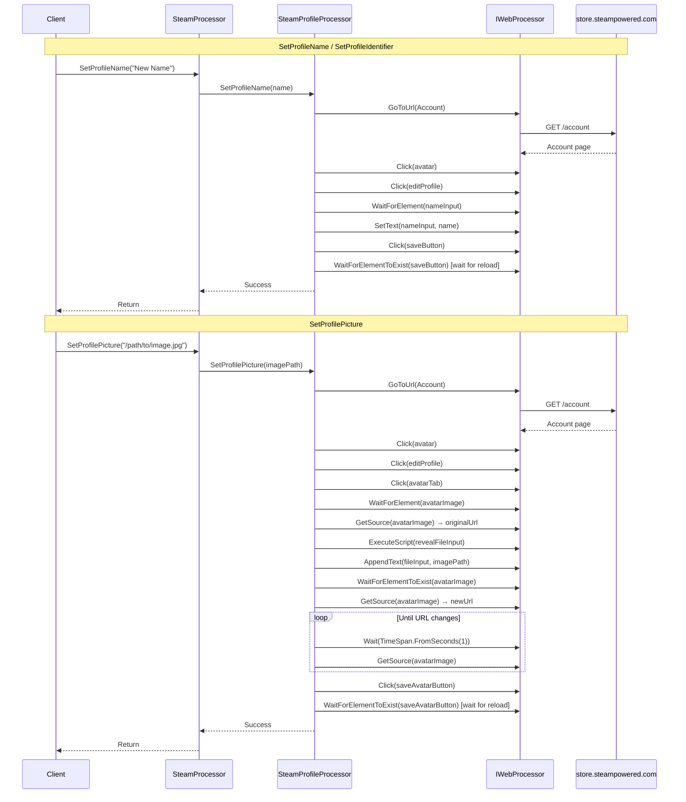

# Profile Management Flow

## Overview

The profile management flow covers three operations: setting profile name, setting custom URL identifier, and setting profile picture (avatar). All operations navigate through the Steam Store account page to the profile edit interface.

## Sequence Diagram



## Detailed Steps

### Common Navigation (All Operations)

```csharp
webProcessor.GoToUrl(SteamUrls.Account); // https://store.steampowered.com/account
webProcessor.Click(avatarSelector);       // Click profile avatar
webProcessor.Click(editProfileSelector);  // Click "Edit Profile"
webProcessor.WaitForElementToBeVisible(profileNameInputSelector);
```

**Selectors:**
| Element | Selector | Type |
|---------|----------|------|
| Avatar link | `//a[contains(@class,'playerAvatar')]` | XPath |
| Edit Profile button | `#edit_profile_btn` | ID |
| Profile name input | `#profile_name` | ID |

---

### SetProfileName

```csharp
public void SetProfileName(string name)
{
    NavigateToEditProfile();

    webProcessor.SetText(profileNameInputSelector, name);
    webProcessor.Click(saveProfileButtonSelector);
    webProcessor.WaitForElementToExist(saveProfileButtonSelector); // Wait for page reload
}
```

**Selectors:**
| Element | Selector | Type |
|---------|----------|------|
| Save button | `//div[@id='profile_edit_form']/div[2]/div[1]/input` | XPath |

---

### SetProfileIdentifier (Custom URL)

```csharp
public void SetProfileIdentifier(string identifier)
{
    NavigateToEditProfile();

    webProcessor.SetText(profileIdentifierInputSelector, identifier);
    webProcessor.Click(saveProfileButtonSelector);
    webProcessor.WaitForElementToExist(saveProfileButtonSelector);
}
```

**Selectors:**
| Element | Selector | Type |
|---------|----------|------|
| Custom URL input | `#profile_custom_url` | ID |
| Save button | (same as name) | XPath |

---

### SetProfilePicture

```csharp
public void SetProfilePicture(string imagePath)
{
    NavigateToEditProfile();

    // Switch to avatar tab
    webProcessor.Click(avatarTabSelector);
    webProcessor.WaitForElementToBeVisible(avatarImageSelector);

    // Capture original avatar URL for comparison
    string originalAvatarUrl = webProcessor.GetSource(avatarImageSelector);

    // Reveal hidden file input via JavaScript
    webProcessor.ExecuteScript(RevealFileInputScript);

    // Upload file
    webProcessor.AppendText(fileInputSelector, imagePath);
    webProcessor.WaitForElementToExist(avatarImageSelector);

    // Poll for avatar URL change (upload completion)
    string newAvatarUrl = webProcessor.GetSource(avatarImageSelector);
    while (newAvatarUrl == originalAvatarUrl)
    {
        webProcessor.Wait(TimeSpan.FromSeconds(1));
        newAvatarUrl = webProcessor.GetSource(avatarImageSelector);
    }

    // Save avatar
    webProcessor.Click(saveAvatarButtonSelector);
    webProcessor.WaitForElementToExist(saveAvatarButtonSelector);
}
```

**Selectors:**
| Element | Selector | Type |
|---------|----------|------|
| Avatar tab | `//a[@href='#avatar']` | XPath |
| Avatar image | `//img[contains(@class,'playerAvatar')]` | XPath |
| File input (hidden) | `//input[@type='file']` | XPath |
| Save avatar button | `//div[@id='avatar_form']/div[2]/div[1]/input` | XPath |

**JavaScript to Reveal File Input:**
```csharp
const string RevealFileInputScript = @"
    var input = document.querySelector('input[type=file]');
    if (input) {
        input.style.display = 'block';
        input.style.visibility = 'visible';
        input.style.opacity = 1;
        input.style.position = 'relative';
        input.style.zIndex = 9999;
    }
";
```

---

## Selectors Reference

| Element | Selector | Type | Used By |
|---------|----------|------|---------|
| Avatar link | `//a[contains(@class,'playerAvatar')]` | XPath | All |
| Edit Profile button | `#edit_profile_btn` | ID | All |
| Profile name input | `#profile_name` | ID | SetProfileName |
| Custom URL input | `#profile_custom_url` | ID | SetProfileIdentifier |
| Save profile button | `//div[@id='profile_edit_form']/div[2]/div[1]/input` | XPath | Name, Identifier |
| Avatar tab | `//a[@href='#avatar']` | XPath | SetProfilePicture |
| Avatar image | `//img[contains(@class,'playerAvatar')]` | XPath | SetProfilePicture |
| File input | `//input[@type='file']` | XPath | SetProfilePicture |
| Save avatar button | `//div[@id='avatar_form']/div[2]/div[1]/input` | XPath | SetProfilePicture |

---

## Error Scenarios

| Scenario | Exception | Recovery |
|----------|-----------|----------|
| Not logged in | `IWebProcessor` exception (element not found) | Call `LogIn` first |
| Name too long/invalid | Steam validation error (not caught) | Validate client-side |
| Identifier taken | Steam validation error (not caught) | Try different identifier |
| Invalid image format | Steam validation error (not caught) | Use JPG/PNG, < 1MB |
| Image upload timeout | `TimeoutException` | Retry, check file size |
| Avatar URL never changes | Infinite loop (no timeout) | Manual intervention |
| Page structure changed | `NoSuchElementException` | Update selectors |
| Network error | `IWebProcessor` exception | Retry operation |

---

## Invariants

1. **Always navigates via Account page** — `GoToUrl(Account)` → Click avatar → Click edit
2. **Name and identifier share save button** — Same form, different inputs
3. **Avatar uses separate form** — Different tab, different save button
4. **File input hidden by default** — Requires JavaScript to reveal
5. **Avatar upload polled** — Compares image `src` attribute before/after
6. **Waits for page reload after save** — `WaitForElementToExist(saveButton)` indicates reload complete

---

## Known Issues

1. **No timeout on avatar URL polling** — `while (newAvatarUrl == originalAvatarUrl)` can loop forever
2. **No validation of name/identifier** — Relies on Steam's server-side validation
3. **Brittle XPath selectors** — Deeply nested, likely to break
4. **JavaScript injection for file input** — May break if Steam changes input structure
5. **Synchronous blocking** — All waits block calling thread
6. **No file size/format validation** — Large/invalid files fail at Steam

---

## Testing

Manual verification required:
1. Valid name change → Success, name updated on profile
2. Valid identifier change → Success, custom URL works
3. Valid image upload → Success, avatar updated
4. Invalid image (wrong format) → Steam error (not caught)
5. Taken identifier → Steam error (not caught)
6. Not logged in → Element not found exception
7. Network interruption during upload → Timeout or exception

---

## Related Documentation

- [Startup and Initialisation](./startup-and-rendering.md) — Processor construction
- [Application Services](../components/application-services.md#steamprofileprocessor) — Implementation details
- [Integration Models](../components/integration-models.md#steam-store-store-steampoweredcom) — Steam Store boundary
- [API Reference](../api-reference/steam-processor.md#setprofilename) — Method signatures