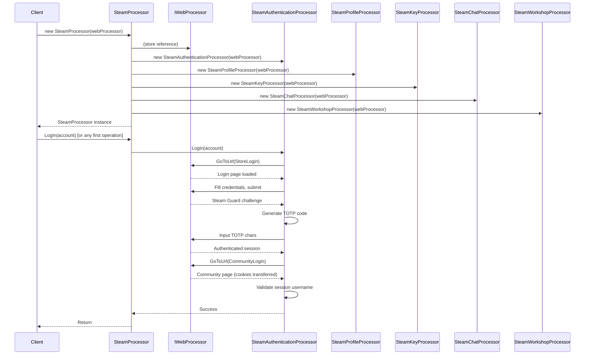

# Startup and Initialisation Flow

## Overview

This flow covers the construction of `SteamProcessor` and the first operation, establishing the browser session and internal processor graph.

## Sequence Diagram



## Step-by-Step

### 1. SteamProcessor Construction

```csharp
var webProcessor = new NuciWeb.WebProcessor(); // or injected
var processor = new SteamProcessor(webProcessor);
```

**Internal Actions:**
1. Store `webProcessor` reference
2. Instantiate `SteamAuthenticationProcessor(webProcessor)`
   - Creates `ISteamGuard` (default: `SteamGuard.TOTP.SteamGuard`)
   - Initialises empty `UsedSteamGuardCodes` list
3. Instantiate `SteamChatProcessor(webProcessor)`
4. Instantiate `SteamKeyProcessor(webProcessor)`
5. Instantiate `SteamProfileProcessor(webProcessor)`
6. Instantiate `SteamWorkshopProcessor(webProcessor)`

**State After Construction:**
- All processors share same `IWebProcessor` instance
- No browser navigation has occurred yet
- `UsedSteamGuardCodes` is empty
- Ready for first operation

### 2. First Operation (Typically LogIn)

```csharp
var account = new SteamAccount
{
    Username = "user@example.com",
    Password = "password123",
    TotpKey = "BASE32SECRET"
};
processor.LogIn(account);
```

**Delegation:** `SteamProcessor.LogIn` → `SteamAuthenticationProcessor.LogIn`

### 3. Authentication Flow Details

See [Authentication Flow](./authentication.md) for complete details.

## Timing and Performance

| Phase | Typical Duration | Notes |
|-------|------------------|-------|
| Construction | < 100ms | Object instantiation only |
| First navigation | 2-5s | Depends on network, browser startup |
| Login form load | 1-3s | Steam Store login page |
| Credential submission | 1-2s | POST to Steam |
| Steam Guard challenge | 2-5s | TOTP generation + input |
| Community login | 1-2s | Cookie transfer, usually fast |
| Session validation | 1-2s | Username check |

**Total first operation:** ~10-20 seconds typical

## Error Scenarios During Startup

| Scenario | Exception | Recovery |
|----------|-----------|----------|
| WebDriver not found | `WebDriverException` | Install ChromeDriver/GeckoDriver |
| Browser fails to start | `WebDriverException` | Check browser installation, permissions |
| Network unreachable | `WebException` | Check connectivity, proxy |
| Steam site changed | `NoSuchElementException` | Update selectors in library |

## Configuration Points

| Setting | Location | Default |
|---------|----------|---------|
| Browser type | `NuciWeb.WebProcessor` config | Chrome |
| WebDriver path | System PATH or NuciWeb config | Auto-detect |
| Implicit wait | `IWebProcessor` implementation | NuciWeb default |
| Page load timeout | `IWebProcessor` implementation | NuciWeb default |

## Invariants

1. **Single IWebProcessor** — All processors share the same browser session
2. **Eager processor creation** — All five processors instantiated at construction
3. **No navigation in constructor** — First navigation occurs on first operation
4. **Stateless processors** — Only `SteamAuthenticationProcessor` holds transient state (`UsedSteamGuardCodes`)

## Related Flows

- [Authentication Flow](./authentication.md) — Detailed login sequence
- [Key Activation Flow](./key-activation.md) — Subsequent key activation
- [Profile Management Flow](./profile-management.md) — Profile operations

## Troubleshooting

| Symptom | Likely Cause | Resolution |
|---------|--------------|------------|
| Constructor hangs | WebDriver startup | Check WebDriver version matches browser |
| "Element not found" on first operation | Steam UI changed | Update selectors in affected processor |
| Session not persisted | Cookie domain mismatch | Verify `IWebProcessor` cookie handling |
| TOTP codes rejected | Time sync | Ensure system clock is accurate |

## Testing

No automated tests for startup flow. Manual verification:
1. Construct `SteamProcessor` with real `WebProcessor`
2. Call `LogIn` with valid credentials
3. Verify successful authentication on both store and community
4. Verify subsequent operations work (profile, keys, etc.)