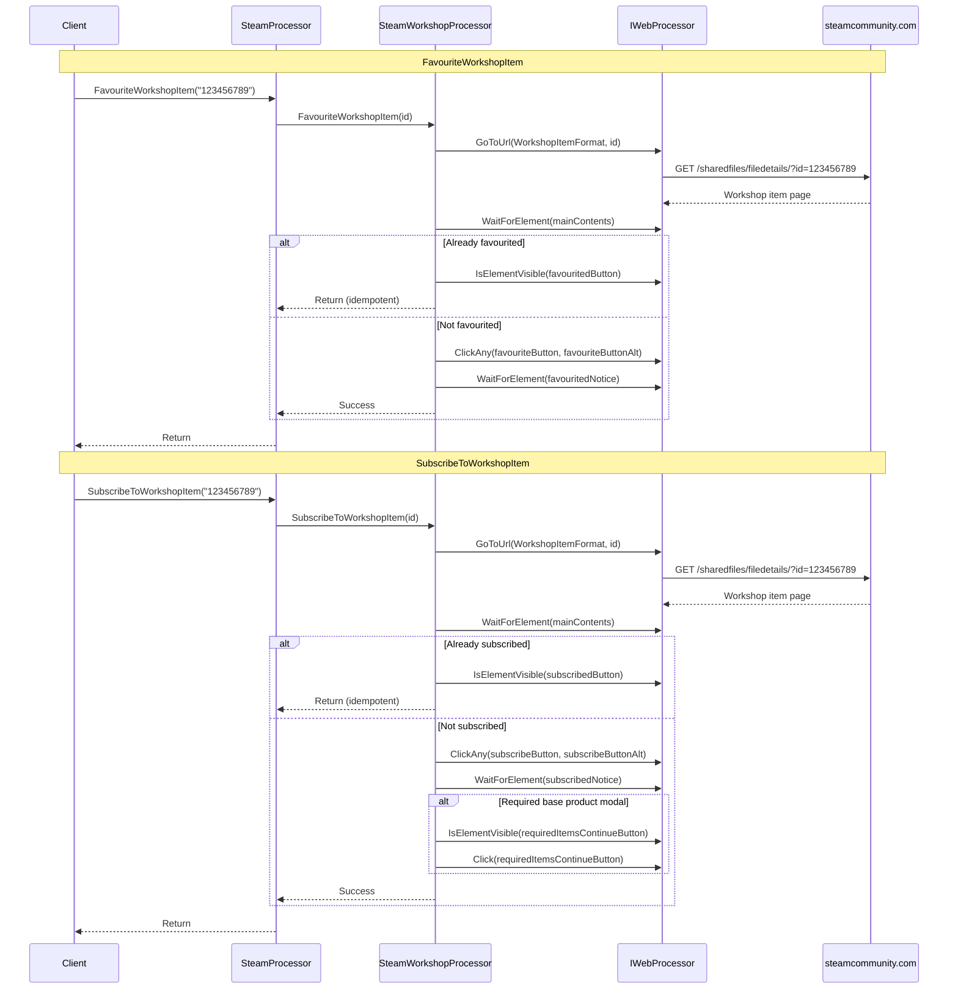

# Workshop Interaction Flow

## Overview

The workshop interaction flow covers two operations: favouriting a workshop item and subscribing to a workshop item. Both operations navigate to the workshop item page on Steam Community, check current state for idempotency, perform the action, and handle confirmation modals.

## Sequence Diagram



## Detailed Steps

### Common Navigation

```csharp
string url = string.Format(SteamUrls.WorkshopItemFormat, workshopItemId);
// https://steamcommunity.com/sharedfiles/filedetails/?id={workshopItemId}

webProcessor.GoToUrl(url);
webProcessor.WaitForElementToBeVisible(mainContentsSelector);
```

**Selector:**
| Element | Selector | Type |
|---------|----------|------|
| Main contents | `#mainContents` | ID |

---

### FavouriteWorkshopItem

```csharp
public void FavouriteWorkshopItem(string workshopItemId)
{
    NavigateToWorkshopItem(workshopItemId);

    // Check if already favourited
    if (webProcessor.IsElementVisible(favouritedButtonSelector))
    {
        return; // Idempotent - already favourited
    }

    // Click favourite button (handles multiple variants)
    webProcessor.ClickAny(favouriteButtonSelector, favouriteButtonAltSelector);

    // Wait for confirmation
    webProcessor.WaitForElementToBeVisible(favouritedNoticeSelector);
}
```

**Selectors:**
| Element | Selector | Type |
|---------|----------|------|
| Favourited state button | `//div[@id='favorite_btn']/a[contains(@class,'favorited')]` | XPath |
| Favourite button (primary) | `//div[@id='favorite_btn']/a` | XPath |
| Favourite button (alt) | `//div[@id='favorite_btn']/a[contains(@class,'btn_grey_white_innerfade')]` | XPath |
| Favourited notice | `//div[@id='favorite_btn']/div[contains(@class,'favorited_notice')]` | XPath |

**Idempotency:** Returns early if `favouritedButtonSelector` is visible.

**Button Variants:** Uses `ClickAny` to handle different button styles (primary vs secondary).

---

### SubscribeToWorkshopItem

```csharp
public void SubscribeToWorkshopItem(string workshopItemId)
{
    NavigateToWorkshopItem(workshopItemId);

    // Check if already subscribed
    if (webProcessor.IsElementVisible(subscribedButtonSelector))
    {
        return; // Idempotent - already subscribed
    }

    // Click subscribe button (handles multiple variants)
    webProcessor.ClickAny(subscribeButtonSelector, subscribeButtonAltSelector);

    // Wait for confirmation
    webProcessor.WaitForElementToBeVisible(subscribedNoticeSelector);

    // Handle required base product modal
    if (webProcessor.IsElementVisible(requiredItemsContinueButtonSelector))
    {
        webProcessor.Click(requiredItemsContinueButtonSelector);
    }
}
```

**Selectors:**
| Element | Selector | Type |
|---------|----------|------|
| Subscribed state button | `//div[@id='SubscribeItemBtn']/a[contains(@class,'subscribed')]` | XPath |
| Subscribe button (primary) | `//div[@id='SubscribeItemBtn']/a` | XPath |
| Subscribe button (alt) | `//div[@id='SubscribeItemBtn']/a[contains(@class,'btn_green_white_innerfade')]` | XPath |
| Subscribed notice | `//div[@id='SubscribeItemBtn']/div[contains(@class,'subscribed_notice')]` | XPath |
| Required items continue | `//div[@class='workshopRequiredItemsContinue']//a[contains(@class,'btn_green_steamui')]` | XPath |

**Idempotency:** Returns early if `subscribedButtonSelector` is visible.

**Required Base Product Handling:** Some workshop items (DLC, mods) require owning the base game. Steam shows a modal with a "Continue" button that must be clicked.

---

## Selectors Reference

| Element | Selector | Type | Used By |
|---------|----------|------|---------|
| Main contents | `#mainContents` | ID | Both |
| Favourited button | `//div[@id='favorite_btn']/a[contains(@class,'favorited')]` | XPath | Favourite |
| Favourite button | `//div[@id='favorite_btn']/a` | XPath | Favourite |
| Favourite button (alt) | `//div[@id='favorite_btn']/a[contains(@class,'btn_grey_white_innerfade')]` | XPath | Favourite |
| Favourited notice | `//div[@id='favorite_btn']/div[contains(@class,'favorited_notice')]` | XPath | Favourite |
| Subscribed button | `//div[@id='SubscribeItemBtn']/a[contains(@class,'subscribed')]` | XPath | Subscribe |
| Subscribe button | `//div[@id='SubscribeItemBtn']/a` | XPath | Subscribe |
| Subscribe button (alt) | `//div[@id='SubscribeItemBtn']/a[contains(@class,'btn_green_white_innerfade')]` | XPath | Subscribe |
| Subscribed notice | `//div[@id='SubscribeItemBtn']/div[contains(@class,'subscribed_notice')]` | XPath | Subscribe |
| Required items continue | `//div[@class='workshopRequiredItemsContinue']//a[contains(@class,'btn_green_steamui')]` | XPath | Subscribe |

---

## Error Scenarios

| Scenario | Exception | Recovery |
|----------|-----------|----------|
| Workshop item not found (404) | `IWebProcessor` exception | Verify item ID |
| Not logged in | `IWebProcessor` exception (element not found) | Call `LogIn` first |
| Network error | `IWebProcessor` exception | Retry operation |
| Page structure changed | `NoSuchElementException` | Update selectors |
| Required base product not owned | Modal handled automatically | User must own base game |
| Rate limited | Steam may show error (not caught) | Wait before retry |

---

## Invariants

1. **Idempotent operations** — Both methods return early if already in target state
2. **Shared navigation** — Both navigate to same workshop item URL format
3. **Button variant handling** — Uses `ClickAny` for primary/alternative button styles
4. **Confirmation wait** — Waits for notice element before returning
5. **Required items modal** — Only for subscribe, handled automatically
6. **No return values** — Both are `void`; success indicated by no exception

---

## Known Issues

1. **No timeout on waits** — `WaitForElementToBeVisible` may hang indefinitely
2. **Brittle XPath selectors** — Depend on specific Steam Community HTML structure
3. **English-only UI assumption** — Selectors may not work with other Steam languages
4. **No verification after modal** — Doesn't confirm subscription succeeded after "Continue"
5. **Synchronous blocking** — All operations block calling thread

---

## Testing

Manual verification required:
1. Favourite unfavourited item → Success, notice appears
2. Favourite already favourited item → Returns immediately (idempotent)
3. Subscribe to unsubscribed item → Success, notice appears
4. Subscribe to already subscribed item → Returns immediately (idempotent)
5. Subscribe to item requiring base game → Modal handled, subscription proceeds
6. Non-existent item ID → Exception (404 or element not found)
7. Not logged in → Exception (buttons not visible)

---

## Related Documentation

- [Startup and Initialisation](./startup-and-rendering.md) — Processor construction
- [Application Services](../components/application-services.md#steamworkshopprocessor) — Implementation details
- [Integration Models](../components/integration-models.md#steam-community-steamcommunitycom) — Steam Community boundary
- [API Reference](../api-reference/steam-processor.md#favouriteworkshopitem) — Method signatures